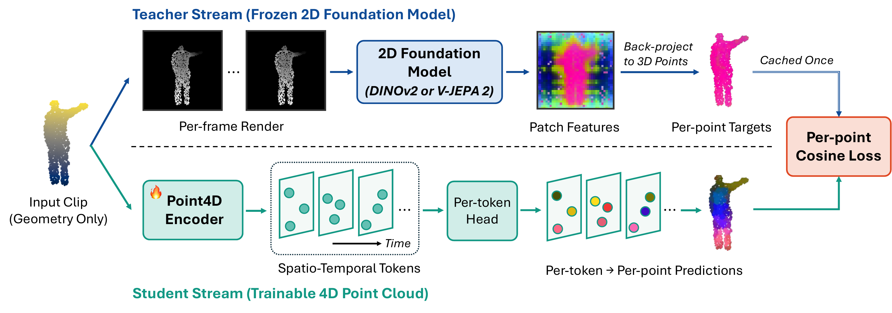

# Cross4D-JEPA: Dense Cross-modal Correspondence Distillation for 4D Point Cloud Representation Learning

**WACV 2027**

Trung Thanh Nguyen<sup>1</sup>, Hai Nguyen-Truong<sup>2</sup>, Tu Vo<sup>3</sup>, Hoang M. Truong<sup>4</sup>, Tuan-Anh Vu<sup>5</sup>

<sup>1</sup>Nagoya University &nbsp; <sup>2</sup>Northeastern University &nbsp; <sup>3</sup>KC Machine Learning Lab &nbsp; <sup>4</sup>University of Science, VNU-HCM &nbsp; <sup>5</sup>University of California, Los Angeles

[Project page](https://tuananh1007.github.io/Cross4D-JEPA/) · [Checkpoints](https://github.com/tuananh1007/Cross4D-JEPA/releases/tag/v1.0) · [BibTeX](#citation)

Cross4D-JEPA pretrains a 4D point-cloud encoder by distilling a **frozen 2D foundation
model** (DINOv2 by default) **densely**. Each frame of a point-cloud clip is rendered from
geometry alone; a z-buffer maps every visible 3D point to the teacher patch it projects to;
and the student is trained to predict, for each spatio-temporal token, the teacher feature
of the surface point it represents, under a cosine loss in latent space, with no masking,
negatives, or decoder. No camera calibration or RGB is needed for any dataset.

Controlled studies in the paper attribute the gain to the **granularity** of the
correspondence (dense per-token targets vs. one global target per clip) rather than to the
teacher: image and video teachers tie, and an untrained teacher recovers most of the gain.



## Contents

- [Installation](#installation)
- [Data](#data)
- [Pretrained checkpoints](#pretrained-checkpoints)
- [Quick start](#quick-start)
- [Reproducing the paper](#reproducing-the-paper)
- [Implementation notes](#implementation-notes)
- [Repository layout](#repository-layout)
- [Citation](#citation)

## Installation

```bash
git clone https://github.com/tuananh1007/Cross4D-JEPA.git
cd Cross4D-JEPA
python -m venv .venv && source .venv/bin/activate          # Python >= 3.10
# Install torch AND torchvision from the same index, matching your CUDA version
# (timm pulls in torchvision; a mismatched build fails at import time).
pip install torch torchvision --index-url https://download.pytorch.org/whl/cu128
pip install -e ".[preprocess,dev]"
pytest                                                      # CPU smoke tests: no data, no downloads
```

The paper's runs used torch 2.11 (CUDA 12.8) and transformers 4.57. Run every command
below from the repository root.

**Teachers.** DINOv2, V-JEPA 2, VideoMAE V2 and the ViT-B/16 controls download from
Hugging Face on first use. On machines without internet access, warm the cache first and
set `HF_HUB_OFFLINE=1`. **DINOv3** is distributed by Meta on request: place
`dinov3_vitl16_pretrain_lvd1689m-8aa4cbdd.pth` in `weights/`.

**Official P4Transformer (optional).** Only the P4Transformer configs
(`configs/ablations/p4t_r*.yaml`) need its compiled PointNet++ CUDA operators. The default
Point4D backbone, which produces every other number, is pure PyTorch.

```bash
git clone https://github.com/hehefan/P4Transformer.git
cd P4Transformer/modules-pytorch-1.8.1 && python setup.py install    # builds pointnet2._ext
```

## Data

Obtain each dataset from its original source under its own license, then preprocess it into
`datasets/` (the configs use these relative paths; edit `data.root` to point elsewhere).

| dataset | used for | expected under `datasets/` |
|---|---|---|
| [MSR-Action3D](https://sites.google.com/view/wanqingli/data-sets/msr-action3d) | Tables 1-4, 6 | `MSRAction3D/aXX_sYY_eZZ_sdepth.npz` |
| [DeformingThings4D](https://github.com/rabbityl/DeformingThings4D) (animals) | Table 1 | `DeformingThings4D/animals/**/*.anime` |
| [NTU RGB+D 60](https://rose1.ntu.edu.sg/dataset/actionRecognition/) | Table 1 | `ntu_npz/SsssCcccPpppRrrrAaaa.npz` |
| [HOI4D](https://hoi4d.github.io/) (semantic segmentation) | Tables 3, 5 | `hoi4d_semseg_sub.npz` |

```bash
# MSR-Action3D: raw depth .bin sequences -> 2,048-point clips
python -m cross4d_jepa.data.datasets.msr_preprocess <raw_msr_dir> datasets/MSRAction3D
# NTU RGB+D 60: masked depth maps (nturgb+d_depth_masked) -> 24-frame, 2,048-point clips
python -m cross4d_jepa.data.datasets.ntu_preprocess <nturgb+d_depth_masked> datasets/ntu_npz --workers 16
```

DeformingThings4D is read directly from the released `.anime` files (extract the archive so
the animal animations sit under `datasets/DeformingThings4D/animals/`). The split is a
deterministic cross-identity split computed by the loader.

The HOI4D results use a subsampled split of the HOI4D 4D semantic-segmentation challenge
data, stored as one file, `datasets/hoi4d_semseg_sub.npz`, with three arrays:
`pcd` (float32, [2221, 24, 2048, 3], metric XYZ), `semantic` (uint8, [2221, 24, 2048],
per-point class, 0 = ignore) and `split` (uint8, [2221]; 1,776 clips with 0 = train,
445 with 1 = test). The test split contains 40 semantic classes. The script that converts
the challenge release into this file is not included yet; until it is, contact the authors
for the exact clip list.

## Pretrained checkpoints

We release **all 128 pretrained encoders behind the six main-paper tables**, at every seed
reported. Each is attached to the [v1.0 release](https://github.com/tuananh1007/Cross4D-JEPA/releases/tag/v1.0)
as part of one archive per table group:

| archive | paper table | contents | size |
|---|---|---|---|
| `cross4d_jepa_main.tar` | Table 1 | MSR dense (5 seeds) / global (8), DT4D and NTU dense / global (5 each) | 433 MB |
| `cross4d_jepa_modality.tar` | Table 2 | MSR dense / global with DINOv3, V-JEPA 2, VideoMAE V2 (5 seeds each) | 394 MB |
| `cross4d_jepa_teacher_capability.tar` | Table 3 | MSR dense with ViT-B/16 ImageNet, ViT-B/16 untrained, raw pixels (3 seeds each) | 118 MB |
| `cross4d_jepa_locality_point4d.tar` | Table 4 | Point4D at token granularity n2 = 16, 4, 2, 1, dense / global (3 seeds each) | 315 MB |
| `cross4d_jepa_locality_p4t_r070.tar` | Table 4 | official P4Transformer, radius 0.7, dense / global (5 seeds each) | 1.68 GB |
| `cross4d_jepa_locality_p4t_radius.tar` | Table 4 | official P4Transformer, radius 0.4 / 0.2 / 0.1, dense (3 seeds each) | 1.51 GB |
| `cross4d_jepa_hoi4d_semseg.tar` | Table 5 | MSR-pretrained (zero-shot) and HOI4D-pretrained (in-domain) dense / global | 53 MB |
| `cross4d_jepa_ssl_baselines.tar` | Table 6 | Uni4D, MaST-Pre (1,200 epochs) and i-JEPA (300 epochs) on Point4D (3 seeds each) | 118 MB |

Cells shared between tables (e.g. the DINOv2 rows of Tables 2-4, 6) reuse the Table 1
files rather than duplicating them. Random-init rows need no checkpoint, and the
fine-tuned weights behind Table 6's fine-tuning row were not kept; its pretrained
initialization is `hoi4d_semseg/msr_dense_dinov2_zeroshot.pt`.

```bash
mkdir -p checkpoints && cd checkpoints
wget https://github.com/tuananh1007/Cross4D-JEPA/releases/download/v1.0/cross4d_jepa_main.tar
tar -xf cross4d_jepa_main.tar && (cd main && sha256sum -c SHA256SUMS) && cd ..
```

[`checkpoints/manifest.json`](checkpoints/manifest.json) lists every file with its
SHA-256, teacher, mode, seed, config, the exact command that trained it, the command that
evaluates it, and **its own logged result for every paper cell it contributes to**. Paper
cells are the mean ± sample standard deviation of those per-seed values.

Each file is a dict: `encoder` (state dict), `cfg` (the full config it was trained with),
`embed_dim`, `run_args` (teacher, dense/global, projection, render size), and `release`
(name and pretraining command). Loading one:

```python
import torch
from cross4d_jepa.config import Config
from cross4d_jepa.models import build_encoder

ck = torch.load("checkpoints/main/msr_dense_dinov2_s0.pt", map_location="cpu")
encoder = build_encoder(Config.from_dict(ck["cfg"]).encoder)
encoder.load_state_dict(ck["encoder"])
out = encoder(points)   # points [B, T, N, 3] -> {"tokens", "global", "token_xyz", "token_t"}
```

## Quick start

Evaluate a released encoder with the frozen-encoder linear probe (MSR-Action3D top-1;
this seed logged 0.8509):

```bash
python -m cross4d_jepa.engine.linear_probe configs/msr_point4d.yaml \
       --encoder checkpoints/main/msr_dense_dinov2_s0.pt
```

Pretrain your own (dense by default; `--global` for the per-clip baseline, `--teacher` to
swap teachers) and probe it:

```bash
export PYTHONHASHSEED=0
python -m cross4d_jepa.engine.pretrain_dense configs/msr_point4d.yaml --seed 0 --out runs/msr_dense
python -m cross4d_jepa.engine.linear_probe configs/msr_point4d.yaml --encoder runs/msr_dense/encoder.pt
```

On MSR-Action3D a dense run (target precompute plus 100 epochs) takes about 35 minutes on a
single GPU; teacher targets are computed once at the start, then the teacher is freed. `python scripts/smoke_dense_train.py` is a
few-minute end-to-end check of the data, teacher download, and dense objective.

### Main result (Table 1)

Linear-probe top-1 with the Point4D student (mean ± std over seeds):

| dataset | chance | random init | global | dense (ours) |
|---|---|---|---|---|
| MSR-Action3D | 0.05 | 0.42 ± .02 | 0.537 ± .056 | **0.829 ± .025** |
| DeformingThings4D | 0.03 | 0.24 ± .02 | 0.334 ± .013 | **0.516 ± .027** |
| NTU RGB+D 60 | 0.02 | 0.11 ± .02 | 0.206 ± .038 | **0.470 ± .010** |

The MSR-Action3D row uses the DINOv2 teacher; the DeformingThings4D and NTU rows use the
V-JEPA 2 teacher set in their configs (pass `--teacher dinov2` to change it).

## Reproducing the paper

One script per table group regenerates every released checkpoint (same configs, flags, and
seeds as `checkpoints/manifest.json`) and evaluates it:

| script | paper table |
|---|---|
| `scripts/reproduce/main.sh` | Table 1: granularity on MSR-Action3D, DeformingThings4D, NTU RGB+D 60 |
| `scripts/reproduce/modality.sh` | Table 2: image vs. video teachers |
| `scripts/reproduce/teacher_capability.sh` | Table 3: non-foundation teachers (+ HOI4D zero-shot mIoU) |
| `scripts/reproduce/locality.sh` | Table 4: token granularity in Point4D, ball-query radius in P4Transformer |
| `scripts/reproduce/hoi4d_semseg.sh` | Table 5: HOI4D 4D semantic segmentation |
| `scripts/reproduce/ssl_baselines.sh` | Table 6: Uni4D / MaST-Pre / i-JEPA on the same student; fine-tuning and label efficiency |

The runs are independent, so the loops are easy to split across a cluster. GPU kernels are
not bit-deterministic, so a re-run lands near, not exactly on, the per-seed values in the
manifest.

Further analyses from the paper and supplement have standalone scripts (each documents its
arguments with `-h`): `eval_robustness.py` (perturbations and frame order),
`token_collision.py` (point/token-to-patch statistics), `target_coverage.py` /
`mv_coverage.py` (teacher target coverage), `exp2_efficiency.py` (parameters and FLOPs),
`run_transfer_eval.py` (cross-dataset transfer), `knn_eval.py`,
`eval_dense_correspondence.py` / `dt4d_correspondence.py` / `eval_crossclip_correspondence.py`
(DeformingThings4D correspondence), and `hoi4d_semseg_supervised.py` (supervised
segmentation ceiling). The latent-forecasting ablation from the supplement is not part of
this release.

The [project page](https://tuananh1007.github.io/Cross4D-JEPA/) is served from `docs/`;
`scripts/make_website_data.py` regenerates its interactive demos from the released
checkpoints (run on a GPU machine with the MSR-Action3D and HOI4D data in place).

## Implementation notes

- **Optimization.** Pretraining processes one clip per optimizer step. The engine reads
  `optim.epochs` and `optim.base_lr` from the config; AdamW weight decay (1e-4), the 5 %
  linear warmup, and the cosine schedule are fixed in code. `optim.batch_size` only affects
  the downstream probe and fine-tuning loaders.
- **VICReg.** Because training is per clip, the VICReg variance term (`loss.vicreg`) is
  inactive; the per-token cosine target alone prevents collapse. The coefficient is kept
  in the configs as it was in the paper's runs.
- **Linear probe.** Frozen encoder, mean-pooled token features, one linear layer trained for
  300 full-batch Adam steps, no feature standardization (it inflates the random-init
  baseline). The head seed comes from the config's `seed`.
- **Determinism.** Export `PYTHONHASHSEED=0`: per-clip point resampling is seeded with
  `hash(clip_id)`, which Python salts per process otherwise.
- **Temporal window (`data.horizons`).** The MSR-Action3D and DeformingThings4D loaders
  resample each video to `num_frames + max(horizons)` frames and use the first `num_frames`.
  Each config pins the value its paper runs used: `configs/msr_point4d.yaml` and the
  Point4D granularity configs use 24 of 28 frames;
  `configs/msr_point4d_resample32.yaml` (Table 6 baselines, Table 5 zero-shot encoders,
  fine-tuning, the MSR random-init probe), the P4Transformer configs, and the
  DeformingThings4D config use `[0, 4, 8]`.
- **Teacher features.** Patch features are random-projected to 384 dimensions before being
  back-projected onto points; render size follows the teacher's patch grid (126 px for
  DINOv2 and raw pixels, 144 px for DINOv3 and the ViT-B/16 controls, 256 px for V-JEPA 2,
  224 px for VideoMAE V2).
- **Memory.** Targets are held in RAM by default (tens of MB per clip). For large corpora,
  `--target-cache-dir DIR` streams per-point targets from disk, and `--token-cache` stores
  only the per-token targets (about 32x smaller), which makes full-split NTU feasible.

## Repository layout

```
configs/                    dataset configs + ablations/ (token granularity, P4Transformer radius)
src/cross4d_jepa/
  config.py                 dataclass config <- configs/*.yaml
  engine/pretrain_dense.py  dense (default) / global (--global) distillation: the method
  engine/linear_probe.py    frozen-encoder linear probe
  engine/finetune.py        end-to-end fine-tuning (label efficiency)
  engine/pretrain_{uni4d,mastpre,ijepa}.py   intra-modal SSL baselines on the same student
  models/encoders/          Point4D (default) and the vendored official P4Transformer
  models/teacher/dinov3.py  DINOv3 loader (the other teachers load from Hugging Face)
  data/render/              geometry -> teacher view renderer and point <-> patch correspondence
  data/datasets/            MSR-Action3D / NTU RGB+D 60 / DeformingThings4D / HOI4D loaders + preprocessing
scripts/reproduce/          one script per paper table
scripts/                    evaluation and analysis scripts (+ make_website_data.py for docs/)
docs/                       project page (GitHub Pages)
checkpoints/manifest.json   every released checkpoint with its command and per-seed results
tests/                      CPU smoke tests
```

## Citation

```bibtex
@inproceedings{nguyen2027cross4djepa,
  title     = {Cross4D-JEPA: Dense Cross-modal Correspondence Distillation for 4D Point Cloud Representation Learning},
  author    = {Nguyen, Trung Thanh and Nguyen-Truong, Hai and Vo, Tu and Truong, Hoang M. and Vu, Tuan-Anh},
  booktitle = {Proceedings of the IEEE/CVF Winter Conference on Applications of Computer Vision (WACV)},
  year      = {2027}
}
```

## License and acknowledgements

The code is released under the [MIT License](LICENSE). The official P4Transformer modules
are vendored from [hehefan/P4Transformer](https://github.com/hehefan/P4Transformer) (MIT);
see [THIRD_PARTY_NOTICES.md](THIRD_PARTY_NOTICES.md). Teacher models (DINOv2, DINOv3,
V-JEPA 2, VideoMAE V2) and all datasets remain under their own licenses. Correspondence:
tuananh.vu@ucla.edu.
